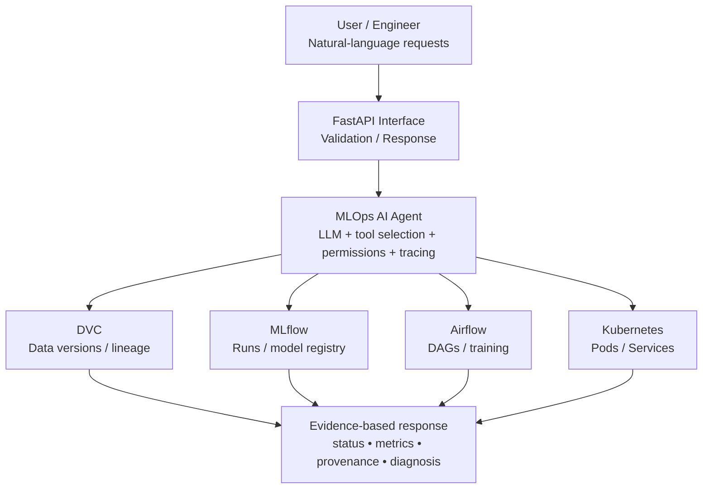
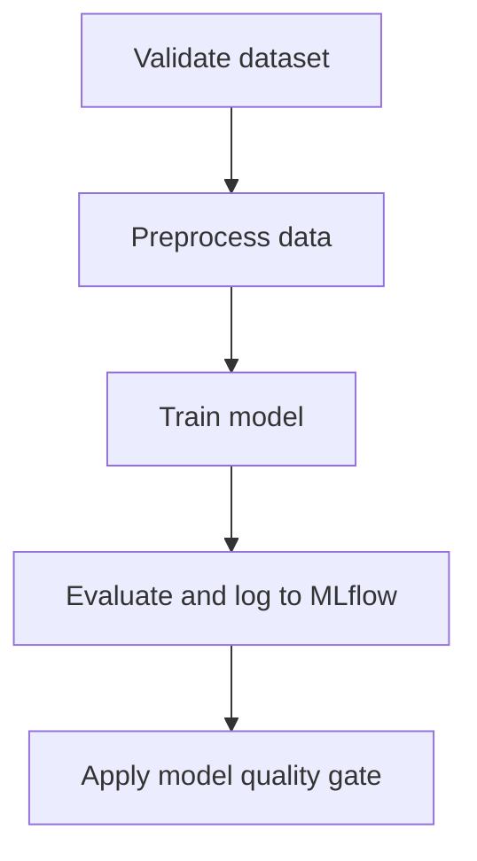

# Assignment No. 3
## Building a Production-Ready MLOps AI Agent
*MLOps & Production AI Engineering | Fall 2026*

| Field | Details |
|---|---|
| Assignment title | Design, Develop, Deploy, and Automate an Intelligent MLOps Agent |
| Total marks | 100 |
| Type | Hands-on programming and systems engineering |
| Programming language | Python |
| Core technologies | Kubernetes, DVC, MLflow, Apache Airflow, FastAPI, Docker, GitHub Actions |

---

## 1. Assignment Overview

Students will design and implement a new AI-powered MLOps Agent capable of understanding natural-language requests, interacting with MLOps tools, executing authorized operations, and explaining results. Unlike a traditional chatbot, the agent must interact with actual infrastructure and machine-learning workflows. It should use DVC for dataset versioning, MLflow for experiment tracking, Apache Airflow for pipeline orchestration, and Kubernetes for deploying and managing an AI application.

The assignment extends the course emphasis on reproducibility, automation, cloud-native deployment, diagnosis, and failure recovery.

### Problem statement

A machine-learning engineer currently performs the following activities manually:

- Identifies the dataset version used for training.
- Searches MLflow for training runs and evaluation metrics.
- Triggers a training pipeline using Airflow.
- Checks whether a model has been successfully deployed on Kubernetes.
- Investigates failures when training or deployment does not succeed.

Your task is to build an AI agent that can assist with these activities through a single conversational interface.

**Example user request:** "Find the best model from our recent experiments, identify the dataset version used for training, and check whether the model is running successfully on Kubernetes."

The agent must determine which tools are needed, execute appropriate operations, collect evidence, and generate an accurate response.

---

## 2. Learning Outcomes

1. Design an AI agent that uses structured tools to interact with external systems.
2. Implement reproducible dataset management with DVC.
3. Track ML experiments, metrics, and artifacts with MLflow.
4. Automate training workflows using Apache Airflow.
5. Deploy and manage containerized workloads using Kubernetes.
6. Integrate multiple MLOps technologies into one operational system.
7. Implement logging, error handling, safety controls, and automated tests.
8. Diagnose failures across data, model, workflow, and infrastructure layers.

---

## 3. Proposed System Architecture



*Figure 1. Logical architecture of the MLOps AI Agent and its four external tool integrations.*

**The agent must not simply generate answers based on its training knowledge. Operational claims must be supported by actual tool responses.**

---

## 4. Functional Requirements

Students must implement the following four modules. Each module should provide at least three callable tools the AI agent can select according to the user request.

### Task 1 — DVC Data Management Agent (15 Marks)

Implement a module that allows the agent to inspect and manage versioned datasets.

- Identify datasets tracked by DVC.
- Retrieve the current dataset version and Git commit.
- Compare dataset versions.
- Detect whether tracked data has changed.
- Explain how to reproduce a previous dataset version.

**Example:** User: "Which dataset version was used for experiment 25?"

**Illustrative agent response:** "Experiment 25 used dataset version v2.1, associated with Git commit a4c92e1. The dataset was retrieved from the configured DVC remote." These values are examples only; the implemented agent must retrieve them from recorded provenance.

**Implementation:** Use Python `subprocess` or an appropriate DVC interface. Restrict commands to approved operations and demonstrate reproducible dataset checkout.

### Task 2 — MLflow Experiment Intelligence Agent (15 Marks)

Implement a module that interacts with an MLflow tracking server.

- List experiments and training runs.
- Retrieve model metrics, parameters, and artifacts.
- Identify the best run according to a specified evaluation metric.
- Compare two or more experiments.
- Retrieve model versions and registry information when available.

**Example:** "Compare the last five training runs and recommend the best candidate based on F1 score."

The agent must return a comparison of recorded results and explain its selection. It must not assume that the highest F1 score automatically makes a model production-ready.

**Technical requirement:** Use `MlflowClient` or supported MLflow Python APIs rather than parsing the MLflow web interface.

### Task 3 — Apache Airflow Workflow Agent (15 Marks)

Implement a module that interacts with Apache Airflow to manage ML workflows.

- List available DAGs.
- Retrieve DAG run status.
- Trigger an approved training DAG.
- Identify failed tasks.
- Retrieve task-execution information and available failure diagnostics.

Students must develop a training DAG containing these logical stages:



*Figure 2. Required training DAG: validation → preprocessing → training → evaluation/MLflow → quality gate.*

The workflow must implement retry behavior, task dependencies, and logging. A failed validation or quality gate must prevent inappropriate downstream promotion.

**Example:** "Trigger the model training pipeline and report whether execution succeeded."

**Technical requirement:** Interact with the Airflow 3 API using authenticated requests or an appropriate client.

### Task 4 — Kubernetes Operations Agent (15 Marks)

Implement a module allowing the agent to inspect and operate an ML application deployed in Kubernetes.

- List application Pods and Deployments.
- Retrieve Pod status and relevant logs.
- Inspect application Services.
- Identify unhealthy Pods and restart events.
- Report the currently deployed application version.

Deploy a containerized FastAPI inference service using Kubernetes manifests containing:

- A Deployment with at least two desired replicas.
- A ClusterIP Service.
- Readiness and liveness probes.
- CPU and memory resource requests and limits.
- A ConfigMap for non-sensitive configuration.

**Example:** "Why is my prediction API unavailable?" The agent should investigate Pod status, health checks, events, and logs, then provide an evidence-based diagnosis.

Any operation changing cluster state must require explicit user confirmation and be limited to an approved namespace.

---

## 5. Integration: Intelligent Multi-Tool Agent (15 Marks)

Integrate the four modules into a single functioning agent. Students may use a suitable agent framework or implement tool calling directly via a supported LLM API. The architecture must support structured tool inputs and outputs. The agent must handle requests requiring more than one tool.

### Mandatory integration scenario

**User:** "Find the best recent model, identify the dataset version used to train it, check the deployment status, and explain whether retraining is necessary."

1. Query MLflow to identify recent experiments and relevant evaluation metrics.
2. Read the recorded DVC dataset reference associated with the selected experiment.
3. Inspect current Kubernetes deployment and application health.
4. Query Airflow to determine the status of recent training workflows.
5. Correlate the collected evidence.
6. Generate a response distinguishing known facts, uncertainties, and recommended actions.

Retraining must not be initiated automatically from this request. Recommend retraining only with evidence such as an explicit freshness policy, failed quality gate, or supplied model-degradation results.

---

## 6. Testing, Reliability, and Safety (10 Marks)

Implement automated tests using `pytest`. Minimum requirements:

- At least eight meaningful automated tests.
- Mocked tool responses for unavailable services.
- Tests for successful tool selection and execution.
- Tests for tool timeouts, invalid requests, and service failures.
- A test proving the agent does not invent operational results when a tool is unavailable.
- A test confirming unauthorized Kubernetes modifications are rejected.
- Structured logs recording tool names, status, duration, and request identifiers without exposing secrets.

Demonstrate at least two deliberately injected failures and explain how the agent diagnoses them.

---

## 7. GitHub Repository and CI (5 Marks)

Maintain a GitHub repository with a reproducible Python environment and GitHub Actions. Recommended structure:

```text
assignment-03-mlops-agent/
├── agent/
│   ├── main.py
│   ├── orchestrator.py
│   ├── tools/
│   │   ├── dvc_tools.py
│   │   ├── mlflow_tools.py
│   │   ├── airflow_tools.py
│   │   └── kubernetes_tools.py
│   └── schemas.py
├── api/
│   └── main.py
├── dags/
│   └── training_pipeline.py
├── data/
├── training/
│   └── train.py
├── kubernetes/
│   ├── deployment.yaml
│   ├── service.yaml
│   └── configmap.yaml
├── tests/
├── screenshots/
├── .github/
│   └── workflows/
│       └── ci.yml
├── Dockerfile
├── dvc.yaml
├── pyproject.toml
├── README.md
└── architecture.md
```

The GitHub Actions workflow must execute linting and automated tests on pull requests. Kubernetes and other external calls should be mocked in ordinary CI runs unless a dedicated test environment is configured.

---

## 8. Demonstration and Engineering Defense (10 Marks)

Demonstrate five scenarios during evaluation:

| Scenario | Expected evidence |
|---|---|
| Dataset provenance | Correct DVC version and reproducible reference |
| Model selection | MLflow metrics and defensible candidate selection |
| Pipeline execution | Real Airflow DAG run and task statuses |
| Deployment diagnosis | Kubernetes health information and relevant logs |
| Multi-tool reasoning | Agent integrates information from all four technologies |

Students must explain their architecture, justify tool choices, and diagnose at least one unexpected failure.

---

## 9. Submission Requirements

Submit one GitHub repository containing source code, infrastructure configuration, tests, and documentation. README must explain installation, environment configuration, launch of each service, test execution, and agent interaction.

Include a short technical report with:

- Complete system architecture.
- Tool definitions and permissions.
- Screenshots or exported evidence from DVC, MLflow, Airflow, and Kubernetes.
- Five tested agent conversations with actual tool evidence.
- Two failure investigations, including root cause and resolution.
- Known limitations and proposed improvements.

> **Never submit API keys, Kubernetes credentials, service-account tokens, or other secrets. Use environment variables and restricted credentials.**

---

## 10. Assessment Rubric

| Component | Marks |
|---|---:|
| DVC integration and data provenance | 15 |
| MLflow experiment intelligence | 15 |
| Airflow DAG and workflow operations | 15 |
| Kubernetes deployment and diagnostics | 15 |
| Multi-tool AI agent reasoning | 15 |
| Testing, reliability, and safety | 10 |
| GitHub repository and CI | 5 |
| Demonstration and architecture defense | 10 |
| **TOTAL** | **100** |
