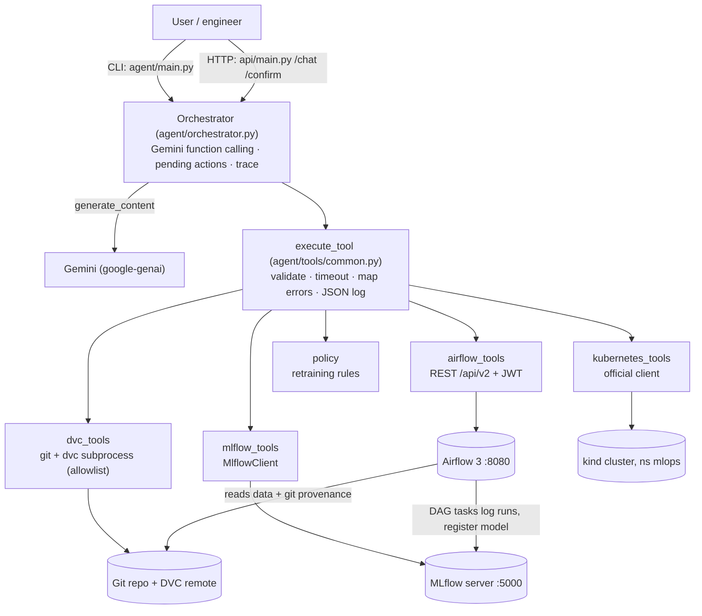

# Architecture

## 1. System overview



Runtime components:

| Component | Runs as | Notes |
|---|---|---|
| Agent (CLI / FastAPI) | host process (`uv run`) | Talks to all four systems and Gemini |
| MLflow 3.18 | docker compose | sqlite backend, proxied artifact store, Host-header allowlist |
| Airflow 3.3.2 | docker compose | LocalExecutor + Postgres 16, FAB auth manager, repo mounted read-only |
| Inference API | kind cluster `mlops`, namespace `mlops` | Deployment ×2, ClusterIP Service, ConfigMap |
| DVC remote | local directory `../mlops-dvc-remote` | Outside the repo |

## 2. Data and model lifecycle

1. `dvc repro` runs `training/prepare_data.py`; `params.yaml` decides the version
   (`data-v1` = seeded 70 % sample, `data-v2` = all 569 rows). `dvc.lock` records the md5;
   each version is a git commit with a `data-v*` tag; data is pushed to the DVC remote.
2. Training (Airflow DAG or `training/train.py`) tags every MLflow run with `git_commit`,
   `git_dirty`, `data_version`, `data_md5` and `data_matches_dvc_lock`. The data version is
   derived by comparing the md5 of the file actually used against `dvc.lock` at the nearest
   `data-v*` tag, so a modified file is recorded as `untagged`, never as a false version.
3. The quality gate (F1 ≥ `QUALITY_GATE_F1`) is the last DAG task and the only code that
   registers a model. Pass → new registry version with provenance tags and alias `candidate`.
   Fail → run tagged `quality_gate=failed`, task fails, nothing registered.
4. `training/export_model.py` copies the `@candidate` version and its provenance
   (`model_info.json`) into the inference image; the image tag, the Deployment's
   `app.kubernetes.io/version` label and ConfigMap `APP_VERSION` name the model version.

## 3. Request flow

1. The CLI or API passes the user message to `Orchestrator.chat`, which sets a `request_id`
   (a context variable added to every log line).
2. The conversation plus the system prompt and 24 function declarations (one per tool; name,
   docstring, JSON schema of its Pydantic input) go to Gemini with automatic function calling
   disabled, so the orchestrator decides what runs.
3. For each function call: unknown tool → structured error; state-changing tool → validated,
   stored as a pending action, **not executed**; otherwise `execute_tool` runs it.
4. All results of a round go back to Gemini in one message (matched by call ID). The loop
   ends when the model answers without calling tools, or after `MAX_TOOL_ROUNDS`.
5. The response contains the answer, every tool call with arguments and structured result,
   the unavailable tools (computed from the results, and appended to the answer text), and
   pending actions. `confirm(action_id)` executes a pending action exactly once.
6. If the LLM call itself fails (quota `429`, timeout, network), the turn is rolled back so
   the conversation stays valid, and the answer states that the language model is unavailable;
   no answer text is produced without the model, and the API never returns a 500 for this.

## 4. Tool contract

Every tool is a function `f(args: <PydanticInput>) -> dict` wrapped by `execute_tool`, which
returns a `ToolResult` (`agent/schemas.py`):

```json
{"tool": "...", "status": "ok | error | unavailable", "data": {...} | null,
 "error": {"type": "...", "message": "..."} | null, "duration_ms": 12.3}
```

| Failure | Status | `error.type` |
|---|---|---|
| Input fails Pydantic validation | error | `invalid_request` |
| Exceeds `TOOL_TIMEOUT_SECONDS` | unavailable | `timeout` |
| Service unreachable (connection refused, no kubeconfig, binary missing) | unavailable | `service_unavailable` |
| Safety policy refuses the operation | error | `rejected` |
| State-changing call awaiting the user | error | `confirmation_required` |
| Any other exception | error | exception class name |

Error messages pass through secret redaction before they reach the LLM or the logs.

## 5. Tool catalogue

| Module | Tool | Purpose | Changes state |
|---|---|---|---|
| DVC | `list_tracked_datasets` | DVC-tracked files with md5, size, remote | no |
| | `get_current_dataset_version` | HEAD commit, nearest `data-v*` tag and whether it matches, md5s, last data commit, workspace clean | no |
| | `compare_dataset_versions` | `dvc diff` + `dvc params diff` + md5 on both sides | no |
| | `check_data_changes` | `dvc status` (workspace) and `dvc status --cloud` (remote) | no |
| | `reproduce_dataset_version` | `dvc get` a revision into `scratch/`, verify md5, return restore steps | no (scratch only) |
| MLflow | `list_experiments` | experiments | no |
| | `list_runs` | recent runs with metrics and provenance tags | no |
| | `get_run_details` | params, metrics, tags, run artifacts + logged-model files, registry versions of a run | no |
| | `find_best_run` | ranking by metric, margin, exclusions, readiness evidence and what is missing | no |
| | `compare_runs` | side-by-side runs, best per metric | no |
| | `compare_experiments` | status counts, gate pass rate, data versions, best/mean metric | no |
| | `get_model_registry_info` | aliases and versions with provenance tags | no |
| Airflow | `list_dags` | DAGs, paused state, whether the agent may trigger them | no |
| | `get_dag_runs` | recent runs with state and timing | no |
| | `trigger_dag` | start an allowlisted DAG run | **yes** |
| | `get_failed_tasks` | failed / upstream-failed / retrying tasks of a run | no |
| | `get_task_logs` | task attempt details, error lines, log tail | no |
| Kubernetes | `list_workloads` | Deployments and Pods | no |
| | `get_pod_status_and_logs` | container states, conditions, events, log tail | no |
| | `list_services` | Services with ready / not-ready endpoint counts | no |
| | `find_unhealthy_pods` | not-ready / waiting / restarting pods + Warning events | no |
| | `get_deployed_version` | image, version label, revision, ConfigMap version, live `/version` via API proxy | no |
| | `restart_deployment` | rolling restart (`restartedAt` annotation) | **yes** |
| Policy | `evaluate_retraining_need` | applies the retraining policy to supplied evidence | no |

## 6. Permissions and safety controls

| Control | Where | What it prevents |
|---|---|---|
| Confirmation gate | `Orchestrator._dispatch` / `confirm` | LLM executing `trigger_dag` or `restart_deployment` by itself; each confirmed action runs once |
| Approved namespace | `kubernetes_tools.restart_deployment` | Changes outside `K8S_APPROVED_NAMESPACE` (checked before any API call) |
| DAG allowlist | `airflow_tools.trigger_dag` | Triggering DAGs other than `AIRFLOW_ALLOWED_DAGS` |
| Command allowlist | `dvc_tools._run_allowlisted` | Any git/dvc command except read-only prefixes; argv only, never a shell |
| Input validation | Pydantic models per tool | Option injection (`--upload-pack=…`), path traversal, malformed IDs |
| Timeouts | `execute_tool`, per-client timeouts | Hanging calls; reported as `unavailable` |
| Evidence-only answers | system prompt + computed `unavailable_tools` | Invented results when a tool is down |
| Secret handling | `.env` (gitignored), `logging_config.redact` | Keys, passwords and bearer tokens in files, logs or LLM context |
| Least privilege in cluster | Pod `runAsNonRoot`, read-only root FS, no privilege escalation | Container compromise impact |
| Read-only repo mount | Airflow containers mount the repo `:ro` | Pipeline tasks modifying source or data versions |

The agent uses the developer's kubeconfig (kind admin). A production deployment should use a
ServiceAccount with a Role limited to `get/list/watch` on pods, logs, events, services,
deployments and configmaps, plus `patch` on deployments in `mlops` only.

## 7. Key design decisions

| Decision | Alternative rejected | Reason |
|---|---|---|
| Hand-written function-calling loop | Agent framework (LangChain etc.) | Fewer layers to defend; confirmation gate and trace live in ~200 lines |
| Confirmation enforced in code | `confirm=true` tool argument | The LLM can set any argument; only the user can call `/confirm` |
| Deterministic retraining policy tool | Let the LLM judge freshness | Reproducible, testable recommendation; LLM only gathers evidence |
| `candidate` = latest gate-passing model | Alias the highest-F1 model | Gate is the promotion rule; "best" is a separate, explained ranking |
| Model baked into the image | Pods download from MLflow at start-up | No cluster→host networking; image tag pins the exact model |
| skops serialization (MLflow 3 default) | pickle / cloudpickle | Loading cannot execute arbitrary code; only reviewed types trusted |
| LocalExecutor + Postgres | CeleryExecutor + Redis | Fits ~8 GB WSL; tasks share `/tmp` for intermediate files |
| DAG tests inside the Airflow image | Install Airflow in the agent env | Airflow pins `fastapi<0.137`; the agent API uses 0.163 |
