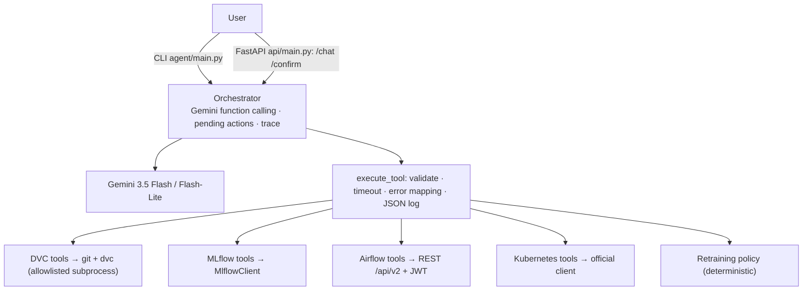

# Technical Report: Production-Ready MLOps AI Agent

*Assignment 03, MLOps & Production AI Engineering, Fall 2026*

All numbers, IDs and outputs in this report come from real executions recorded on
2026-11-15 in [`docs/evidence/`](evidence/). Nothing was edited after capture except Markdown headings
and the review notes, which are marked as such.

## 1. System architecture

The agent answers natural-language operational questions by calling 24 structured tools over four
systems and returning an answer whose claims are traceable to tool results. Full design:
[architecture.md](../architecture.md).



| Layer | Technology (version) | Role |
|---|---|---|
| Data versioning | DVC 3.67.1, local remote | `prepare` stage; `data-v1` (398 rows, md5 `e1c1c472…`) and `data-v2` (569 rows, md5 `b154f6a7…`) as git tags |
| Experiment tracking | MLflow 3.18.0 server (compose) | Runs tagged with git commit, data version, data md5, gate result; registry alias `candidate` |
| Orchestration | Airflow 3.3.2, LocalExecutor, Postgres 16 | DAG `training_pipeline`: validate → preprocess → train → evaluate/log → quality gate |
| Serving | kind (Kubernetes v1.37.0), FastAPI | `inference-api` Deployment ×2, ClusterIP Service, ConfigMap, probes, limits |
| Agent | Python 3.12, google-genai 3.3.0, FastAPI | Manual function-calling loop, confirmation gate, structured results, JSON logs |
| LLM | Gemini (`gemini-3.5-flash`; `gemini-3.5-flash-lite` for later runs, see §7) | Tool selection and answer writing only |

**Why these choices.** A hand-written loop (`agent/orchestrator.py`, about 270 lines including the system prompt) keeps the
safety controls visible and testable, where a framework would hide them. The model is baked into the
inference image, so the deployed version is pinned by its image tag and the cluster needs no network
access to MLflow. Retraining decisions come from a deterministic policy function, not from the LLM's judgement.

## 2. Tool definitions and permissions

Every tool takes a Pydantic input model and returns
`ToolResult{tool, status: ok|error|unavailable, data, error{type,message}, duration_ms}`. The full
catalogue is in [architecture.md §5](../architecture.md#5-tool-catalogue).

| Module | Tools | State-changing |
|---|---|---|
| DVC (5) | `list_tracked_datasets`, `get_current_dataset_version`, `compare_dataset_versions`, `check_data_changes`, `reproduce_dataset_version` | none (`dvc get` writes only to `scratch/`) |
| MLflow (7) | `list_experiments`, `list_runs`, `get_run_details`, `find_best_run`, `compare_runs`, `compare_experiments`, `get_model_registry_info` | none |
| Airflow (5) | `list_dags`, `get_dag_runs`, `trigger_dag`, `get_failed_tasks`, `get_task_logs` | `trigger_dag` |
| Kubernetes (6) | `list_workloads`, `get_pod_status_and_logs`, `list_services`, `find_unhealthy_pods`, `get_deployed_version`, `restart_deployment` | `restart_deployment` |
| Policy (1) | `evaluate_retraining_need` | none |

**Permission model**, all enforced in code:

1. **Confirmation gate** (`Orchestrator._dispatch`): the LLM can only *request* `trigger_dag` or
   `restart_deployment`. The request is validated, stored as a pending action, and runs only when the
   user calls `/confirm <id>` (CLI) or `POST /confirm` (API). It runs exactly once.
2. **Approved namespace** (`restart_deployment`): anything other than `K8S_APPROVED_NAMESPACE=mlops` is
   rejected before any API call, **even after the user confirms** (evidence: scenario 4).
3. **DAG allowlist** (`trigger_dag`): only `AIRFLOW_ALLOWED_DAGS` (`training_pipeline`).
4. **Command allowlist** (`dvc_tools._run_allowlisted`): only read-only git/dvc prefixes, passed as an argv
   list with no shell. Revisions must match a pattern that cannot start with `-`.
5. **Timeouts** on every external call, mapped to `unavailable`. **Secret redaction** in logs and in error
   messages sent to the LLM. All credentials come from the gitignored `.env`.

## 3. Evidence from DVC, MLflow, Airflow and Kubernetes

Raw command output: [`evidence/system_exports.md`](evidence/system_exports.md). Highlights:

- **DVC.** `dvc params diff data-v1 data-v2` shows `sample_frac 0.7 → 1.0`. `dvc diff` shows
  `e1c1c472..b154f6a7 data/breast_cancer.csv`. Cache and remote are in sync.
- **MLflow.** 11 runs in 2 experiments, and every run carries `data_version`, `data_md5` and
  `git_commit`. Runs `974fb6cc`/`25606340` (`git_dirty=false`, commit `3cce5da` = tag `data-v2`) have
  fully clean provenance. The registry holds versions v1–v7 with provenance tags, and `@candidate` = v7.
  Three early runs are `FAILED` (missing `skops` / an untrusted type during development) and are kept as
  history. Run `95f960db` was deliberately gated at 0.99 to prove that a failed gate registers nothing.
- **Airflow.** 4 DAG runs: 3 `success` with 5/5 tasks each, and 1 `failed` (`validate_dataset=failed`,
  4 × `upstream_failed`) from the injected failure B.
- **Kubernetes.** 2/2 replicas Ready, ClusterIP `10.96.72.129:80` with an EndpointSlice of 2 pod IPs,
  probes `/ready` and `/health`, requests 100m/256Mi, limits 500m/512Mi, `envFrom` ConfigMap
  `inference-config`. Rollout history shows the restart (scenario 4) and the rollback (failure A).

### Screenshots to capture (not producible from this environment)

I cannot take UI screenshots from the terminal. Please capture these and save them under the given paths:

| # | File | What to capture | How |
|---|---|---|---|
| S1 | `screenshots/mlflow_runs.png` | MLflow experiment `breast-cancer-classification` run table showing f1 and the `data_version`, `git_commit`, `quality_gate` columns | http://localhost:5000 → Experiments → add tag columns |
| S2 | `screenshots/mlflow_registry.png` | Model `breast-cancer-classifier`, versions v1–v7, alias `candidate` on v7 | http://localhost:5000 → Models |
| S3 | `screenshots/airflow_grid.png` | `training_pipeline` grid with 3 green runs and the red 17:10 run | http://localhost:8080 (user `admin`, password from `.env`) → DAGs → training_pipeline → Grid |
| S4 | `screenshots/airflow_validate_log.png` | Log of `validate_dataset` in run `manual__2026-11-15T17:10:08…`, showing "data validation failed: 5 missing values" | Grid → failed task → Logs |
| S5 | `screenshots/k8s_healthy.png` | `kubectl -n mlops get deploy,pods,svc,endpointslices` | terminal |
| S6 | `screenshots/dvc_versions.png` | `git tag -n1` + `uv run dvc params diff data-v1 data-v2` + `uv run dvc status` | terminal |
| S7 | `screenshots/agent_cli.png` | an agent CLI session showing a pending action and `/confirm` | `uv run --env-file .env python -m agent.main` |
| S8 | `screenshots/agent_api_docs.png` | FastAPI Swagger page of the agent API | `uv run --env-file .env uvicorn api.main:app` → http://localhost:8000/docs |
| S9 | `screenshots/github_actions.png` | Green CI run (both jobs) | GitHub → Actions, after you push |

Screenshot placeholders: S1  · S2  ·
S3  · S4  ·
S5  · S6  ·
S7  · S8  ·
S9 

## 4. Five tested agent conversations

Each transcript lists every tool call with its arguments and full JSON result, followed by the agent's answer.

| # | Scenario (spec §8) | Transcript | Tools called | Outcome |
|---|---|---|---|---|
| 1 | Dataset provenance | [scenario_1](evidence/scenario_1_dataset_provenance.md) | `get_model_registry_info`, `reproduce_dataset_version` | Candidate v6 → `data-v2`, commit `3cce5da`, md5 `b154f6a7…`; dataset re-fetched with `dvc get` and md5 verified; restore steps given |
| 2 | Model selection | [scenario_2](evidence/scenario_2_model_selection.md) | `list_runs`, `find_best_run`, `get_model_registry_info`, `get_deployed_version` | Best F1 = run `974fb6cc` (0.9861, v3). Agent flagged the 0.005 margin as noise on 114 test rows and that v3 is **not** the alias or the deployed model; recommended evaluation, not promotion |
| 3 | Pipeline execution (via HTTP API) | [scenario_3](evidence/scenario_3_pipeline_execution.md) | `trigger_dag` (held → confirmed), `get_dag_runs`, `get_failed_tasks`, `list_runs` (**error**: model guessed experiment `default`; answer did not rely on it), `get_model_registry_info`, `get_run_details` | Trigger held as `1943a805` until `POST /confirm`; run `manual__2026-11-15T17:02:39…` 5/5 success → MLflow run `c1dca733` (F1 0.9861) → v7 `@candidate` |
| 4 | Deployment diagnosis + guarded changes (API) | [scenario_4](evidence/scenario_4_deployment_diagnosis.md) | `list_workloads`, `list_services`, `get_deployed_version`, `find_unhealthy_pods`, `get_pod_status_and_logs` ×2, `restart_deployment` ×2 | Healthy 2/2 with probe logs and live `/version`. `kube-system` restart: held → confirmed → **rejected** (namespace). `mlops` restart: held → confirmed → executed (revision 2) |
| 5 | Multi-tool reasoning (§5) | [scenario_5](evidence/scenario_5_multi_tool_reasoning.md) | attempt 2: `find_best_run`, `get_current_dataset_version`, `get_deployed_version`, `get_dag_runs`, `evaluate_retraining_need` | Facts / Uncertainties / Recommended actions; retraining **not** recommended (gate passed, 0.04 days old, data current); deployed v6 ≠ best run flagged; nothing triggered |

**What the scenarios showed beyond the happy path:**

- Scenario 5 **attempt 1** did not query Airflow and hid the deployed-versus-best mismatch. I tightened
  system-prompt rules 4–5 and re-ran the same question; attempt 2 satisfies every step of §5. Both
  attempts are kept in the transcript.
- Scenario 4's last message hit Gemini's free-tier limit (`429 RESOURCE_EXHAUSTED`, 20 requests per day
  per model). This exposed a missing error path: the API returned HTTP 500. It now returns an explicit
  "language model is unavailable" answer (test `test_llm_failure_returns_honest_answer_and_keeps_history_valid`).

## 5. Failure investigations

### Failure A: bad image tag → ImagePullBackOff ([evidence](evidence/failure_a_image_pull.md))

- **Injection:** `kubectl -n mlops set image deploy/inference-api inference-api=mlops-inference:model-v99`.
- **Symptom:** new pod `inference-api-756b9ff476-h9sbn` in `ImagePullBackOff`. Event: `pull access denied,
  repository does not exist`.
- **Agent diagnosis** ("Why is my prediction API unavailable?"): `list_services` showed 2 ready and 1 not-ready
  endpoint; `find_unhealthy_pods` showed the waiting reason and the pull error; `get_deployed_version` showed the
  Deployment now references `model-v99`.
- **Root cause:** the tag was never built or loaded into the node. Rolling update (maxUnavailable 0 with 2
  replicas) kept the old v6 pods serving, so the *rollout* was stuck while the API stayed up.
- **Resolution:** `kubectl rollout undo` (operator; the agent deliberately has no image-changing tool). The
  agent then verified 2/2 ready on `model-v6`.
- **Lessons:** the diagnosis was correct and every claim was traceable. The smaller model added one unbacked
  detail ("model-v5") and confused `alias_at_export` with the current registry alias. The trace makes such
  lapses visible.

### Failure B: corrupted data → failed validation ([evidence](evidence/failure_b_validation.md))

- **Injection:** blanked `mean_radius` in 5 rows of `data/breast_cancer.csv`; `dvc status` reported `modified`.
- **Pipeline behaviour:** the agent's trigger was held (`32c61fbb`) and then confirmed. In run
  `manual__2026-11-15T17:10:08…`, `validate_dataset` raised `AirflowFailException` ("data validation failed:
  5 missing values"). It failed **without retries** (deterministic failure), the 4 downstream tasks were
  `upstream_failed`, the gate never ran, and **no model version was registered**.
- **Agent diagnosis, attempt 1** found the failed task and the modified file but reported only "Task failed
  with exception": Airflow 3 stores exception details in the structured `error_detail` field, which
  `get_task_logs` ignored. It also queried the registry with a wrong model name.
- **Fix:** `airflow_tools._log_line` now includes `exc_type: exc_value` (new test), and the registry tool
  description names the default model.
- **Agent diagnosis, attempt 2:** named the exact exception (5 missing values), linked it to
  `check_data_changes`, and confirmed from the registry that `@candidate` was still v7.
- **Resolution:** `dvc checkout --force data/breast_cancer.csv` restored md5 `b154f6a7…`; `dvc status` clean.

## 6. Testing, reliability and logging

- `uv run pytest`: **63 passed, 1 skipped**. The skipped file is the DAG tests, which need Airflow and pass
  inside the Airflow image: **4 passed**. ruff and mypy (strict, `agent/` and `api/`) are clean. The same
  steps passed in a fresh `uv sync --locked` environment.
- All external services are mocked in tests: fake `subprocess.run`, fake `MlflowClient`,
  `httpx.MockTransport` for Airflow, fake Kubernetes API objects, and a scripted LLM that returns real
  `google-genai` response types.

| Spec §6 requirement | Tests |
|---|---|
| ≥ 8 meaningful tests | 63 + 4 DAG tests across 10 files |
| Mocked responses for unavailable services | `test_unreachable_*` / `test_missing_dvc_binary_*` (all four modules) |
| Tool selection and execution | `test_selected_tool_is_executed_and_result_returned_to_model`, `test_integration_scenario_uses_all_four_systems_without_retraining` |
| Timeouts, invalid requests, service failures | `test_timeout_reports_unavailable_without_data`, `test_invalid_request_*`, `test_malformed_*`, `test_invalid_chat_requests_are_rejected`, `test_failures_map_to_structured_status`, `test_llm_failure_*` |
| Agent does not invent results when a tool is unavailable | `test_unavailable_tool_is_surfaced_even_if_model_text_omits_it` |
| Unauthorized Kubernetes modifications rejected | `test_restart_outside_approved_namespace_is_rejected_before_any_api_call`, `test_state_changing_call_waits_for_explicit_confirmation` |
| Structured logs without secrets | `test_structured_log_has_required_fields_and_no_secrets`; real logs in `evidence/logs/*.jsonl` |

Example log line (from `evidence/logs/scenario_1.jsonl`):

```json
{"ts": "2026-11-15T17:01:16.720273+00:00", "level": "INFO", "logger": "agent.tools", "request_id": "a9aab93d9b94", "message": "tool call finished", "tool": "get_model_registry_info", "status": "ok", "duration_ms": 291.3, "error_type": null, "event": "tool_call"}
```

## 7. Deviations, unverified items and disclosures

- **LLM model changed during evidence collection.** Scenarios 1–4 used `gemini-3.5-flash`. After its
  free-tier daily quota (20 requests per model) ran out, scenario 5 and both failure investigations used
  `gemini-3.5-flash-lite` at the user's direction. Each transcript names its model.
- **Gemini model availability:** `gemini-2.5-flash` is closed to new users, and `gemini-3.7/3.8-flash`
  returned `504 DEADLINE_EXCEEDED` on this key, so `gemini-3.5-flash` became the default.
- **Inaccurate Airflow run note:** run `manual__2026-11-15T16:24:03…` carries the note "triggered by MLOps
  agent after explicit user confirmation". I actually triggered it by calling `trigger_dag` directly while
  verifying the tool (PLAN item 3.3), outside the confirmation flow. The note is hard-coded in the tool.
- **`git_dirty=true` on most runs:** these runs trained while code was uncommitted. Data provenance is
  unaffected, because it comes from the data md5 and the `data-v*` tag.
- **GitHub Actions:** the workflow ran locally step for step, but a real GitHub run is unverified until the
  repository is pushed.
- **Screenshots:** not captured. See the checklist in §3.
- **Run artifacts (fixed during final verification):** MLflow 3 stores models as separate "logged models", so
  `get_run_details` originally returned an empty artifact list. It now also returns each logged model's files
  (test `test_run_details_include_logged_model_artifacts`; live output at the end of `system_exports.md`). The five
  scenario transcripts were recorded before this fix.
- **Airflow 3.3.2 rather than 3.4.0:** 3.4.0 had been out for only 9 days, so the last patch of the
  previous minor version was chosen.

## 8. Known limitations and proposed improvements

| Limitation | Improvement |
|---|---|
| The agent uses the developer's kind admin kubeconfig | Dedicated ServiceAccount + Role: read verbs on pods/logs/events/services/deployments/configmaps, `patch` on deployments in `mlops` only |
| Pending actions and sessions live in memory (lost on restart; single process) | Store sessions and pending actions in Redis/Postgres with expiry; add authentication to the agent API |
| Small LLMs occasionally add unbacked details (e.g. "model-v5") | Post-answer check that every ID/version in the answer appears in the tool trace; flag ungrounded tokens |
| Retraining policy relies on evidence the LLM passes in | Let the policy tool fetch gate, age and data version itself from MLflow/DVC |
| Quality gate is an absolute F1 threshold | Add a champion/challenger comparison against the deployed model and a fairness/calibration check |
| Small dataset (114-row test split): F1 differences < 0.01 are noise | Cross-validation with confidence intervals logged to MLflow |
| Model export and image build are manual | CI job: on a new `@candidate`, build, scan and push the image, then deploy behind an approval step |
| Airflow tasks share `/tmp` (LocalExecutor only) | Use an object store (e.g. MinIO) for intermediate artifacts to allow Celery/Kubernetes executors |
| Trigger note is a fixed string | Pass the confirming user and action ID into the DAG run note |
